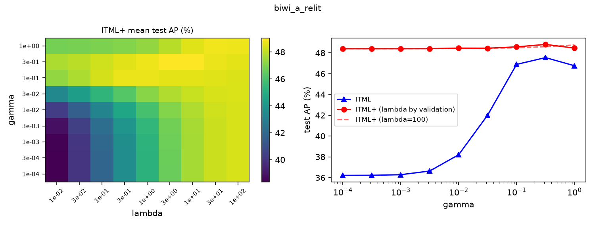

# ITML+ reproduction

This repo reproduces ITML+ from

> X. Xu, W. Li, D. Xu. *Distance Metric Learning Using Privileged Information for Face Verification and Person Re-Identification.* IEEE TNNLS 26(12):3150–3162, 2015.

The setting: training images have RGB and depth, test images only RGB. ITML+ uses the depth as privileged information. It takes ITML and replaces the free slack variable of each training pair with that pair's distance in depth space, d_P(z_i, z_j), so it learns an RGB metric M and a depth metric P together.

Everything in the paper is implemented here: ITML+, partial ITML+, the six baselines (L2, SVM, ITML, LMNN, ITML-S, SVM+), the G-LBP and KDES+EMK features, and the experiments behind Tables I–IV and Fig. 2–4. The ITML, ITML+ and SVM+ solvers were checked against cvxpy.

## Short version

On the original data, learning a metric helps a lot (9 to 19 AP over plain L2), just like in the paper. ITML+ itself, however, ends up tied with ITML. Over 20 random splits it is 0.43 AP lower on BIWI-A and 0.21 lower on BIWI-B, whereas the paper reports a clear gain.

We think the reason is the data. The paper's argument (its Fig. 1) is that depth stays the same when the lighting changes. Our faces were recorded under constant room light, and the main nuisance is head pose, which changes the depth map as much as the color image. So we re-lit the RGB faces at random and left the depth alone. With that change, ITML+ does beat ITML: +1.43 AP on BIWI-A (16 of 20 splits, p = 0.003) and +0.96 AP on BIWI-B (18 of 20, p < 0.0001). That is still smaller than the paper's +2.7 / +3.5, and the lighting is simulated, so treat it as a check of the mechanism rather than a full replication.

| ITML → ITML+ | Paper | Ours, original data | Ours, simulated lighting |
|---|---|---|---|
| EUROCOM / BIWI-A (AP) | 84.16 → 86.82 | 72.99 → 72.56 | 45.14 → 46.57 |
| CurtinFaces / BIWI-B (AP) | 75.19 → 78.73 | 80.50 → 80.29 | 67.10 → 68.05 |
| BIWI RGBD-ID Walking / UW Cross (rank-1) | 46.62 → 48.23 | 46.72 → 48.64 | 27.76 → 26.40 |
| BIWI RGBD-ID Still / UW Seq (rank-1) | 92.89 → 95.23 | 85.60 → 85.76 | 58.32 → 59.44 |

Face numbers are means over 20 splits, re-ID over 5. None of the re-ID differences is significant.

## Data

We could not get any of the paper's data sets. EUROCOM only licenses to institutions, the CurtinFaces page is offline, and the BIWI RGBD-ID download page is gone. We used two public Kinect data sets instead and do not redistribute them.

For faces we use the BIWI Kinect Head Pose database (20 people, RGB + depth with head pose). BIWI-A keeps near-frontal frames (|yaw| and |pitch| up to 30°, 22 images per person) and stands in for EUROCOM. BIWI-B allows larger poses (|yaw| up to 60°, |pitch| up to 45°, 95 images per person) and stands in for CurtinFaces. Faces are cropped at a fixed physical size around the 3-D face centre and resized to 120 × 105, as in the paper.

For re-identification we use the evaluation set of the Washington RGB-D Object data: 300 object instances, matched across camera elevations instead of across people.

## Protocol

Features, PCA size (150), pair sampling, hyper-parameter grids, the u/l targets and the iteration limit follow the paper. BIWI only has 20 people, so each split uses 10 for training, 5 for validation and 5 for testing, and the people are re-drawn for every split. The key comparisons are run over 20 splits rather than 5, with paired t-tests.

For re-ID we test on all 250 remaining instances. "Cross" (probe at 30° elevation, gallery at 45° and 60°) plays the role of Walking, and "Seq" (frames from the same video) plays the role of Still. RGB and depth features are also scaled to the same mean squared distance, since ITML+ compares d_M with d_P directly.

## Results

All eight methods, AUC values and the selected hyper-parameters are in [`results/summary.md`](results/summary.md) and [`results/summary_relit.md`](results/summary_relit.md). Below are the AP (faces) and rank-1 (re-ID) numbers for the paper's protocol over 5 splits, with the paper's values in brackets.

| | L2 | SVM | ITML | LMNN | ITML-S | SVM+ | ITML+ |
|---|---|---|---|---|---|---|---|
| BIWI-A | 55.9 (58.8) | 54.5 (66.0) | 73.1 (84.2) | 74.5 (84.3) | 73.1 (83.9) | 53.4 (66.0) | 71.9 (86.8) |
| BIWI-B | 73.1 (62.1) | 72.3 (71.9) | 82.5 (75.2) | 82.0 (71.7) | 82.3 (74.6) | 73.7 (71.9) | 82.3 (78.7) |
| UW Cross | 47.8 (34.6) | 24.8 (31.8) | 46.7 (46.6) | 43.8 (33.1) | 46.5 (46.7) | 13.0 (26.8) | 48.6 (48.2) |
| UW Seq | 82.6 (85.8) | 65.9 (81.2) | 85.6 (92.9) | 85.7 (86.1) | 85.1 (93.0) | 35.3 (79.2) | 85.8 (95.2) |

To see how much depth could help in principle, `scripts/diag_upper_bound.py` trains plain ITML on BIWI-A with depth available at test time too. That breaks the paper's setting on purpose, so it is only an upper bound. RGB alone gives 73.1 AP, depth alone 69.5, and the two concatenated 77.7. So there is information in the depth that ITML+ does not manage to pass on to the RGB metric. Scaling the features differently, running 30 sweeps instead of 10, widening the γ grid to 1e2 or using the uncorrected Lemma 2 (see below) did not change that.

The re-lighting is done by `scripts/make_relit.py`. Each RGB face gets Lambert shading from the normals of its own depth map, with a random light direction (25–70° off the viewing axis), exposure and gamma. A control run through the same code without re-lighting gives the original numbers back. In the re-lit setting, validation picks λ between 0.3 and 10, while on the original data it picks 0.01, which turns ITML+ back into ITML. The method ranking on BIWI-B then looks like the paper's Table II, and the Fig. 2 trend (more privileged pairs, higher AP) shows up as well. On the object data, re-lighting gives no consistent gain, probably because Kinect depth of small objects is too noisy.

| 20 splits, ITML+ minus ITML (AP) | original light | simulated lighting |
|---|---|---|
| BIWI-A | −0.43 (6/20 wins, p = 0.06) | +1.43 (16/20, p = 0.003) |
| BIWI-B | −0.21 (10/20, p = 0.23) | +0.96 (18/20, p < 0.0001) |



## Two things we ran into

Lemma 2 as printed uses α = max{0, ·}, so a projection is never undone. ITML's original code keeps a dual variable per constraint and allows undoing it (Hildreth's method). Without that, the cyclic projections stop at a feasible point that is not the optimum; on small problems the objective ends up 0.2 to 2.6 above it. With α = max{−Λ_ij, α_eq} the result matches cvxpy on objective (4) to about 1e-11. "ITML+" in the results is the corrected version, and `ITML+ (Lemma 2 verbatim)` is kept next to it. In practice the two differ by less than 0.7 AP.

The ITML+ constraints are also homogeneous: if (M, P) satisfies y·d_M ≤ y·d_P, so does (cM, cP). With far more pairs than parameters, objective (4) may then have no minimiser. We did not see this happen within 10 sweeps on the real data.

## Running it

```bash
conda create -n itmlplus python=3.11 && conda activate itmlplus
pip install -r requirements.txt
```

The code expects the data next to the repository:

```
../data/raw/uw_rgbd/extracted/rgbd-dataset_eval/     # rgbd-dataset_eval.zip from rgbd-dataset.cs.washington.edu
../data/raw/biwi_headpose/BIWI/data/faces_0.zip       # BIWI Kinect Head Pose
../data/raw/biwi_headpose/extracted/db_annotations/   # db_annotations.zip
```

Then run the solver checks in `tests/` (`python tests/test_metric.py` and so on) and everything else with

```bash
ITMLPLUS_JOBS=8 bash scripts/run_all.sh
```

which writes `results/` and `figures/`. Each worker needs less than 1 GB of RAM, and the KDES features and LMNN use a GPU if there is one.

The library code is in `itmlplus/`: the solvers in `metric.py`, the baselines in `baselines.py`, the features in `features.py`, data loading in `biwi.py` and `uw_rgbd.py`, and the evaluation loop in `protocol.py` and `experiment.py`. `scripts/` has one script per experiment plus `summarize.py`, which turns the JSON results into the tables and plots.
